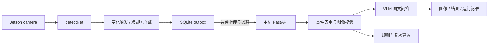

# Roadside Multimodal Agent

**面向路侧视觉事件的端云协同原型：端侧轻量检测与事件筛选，主机 VLM 问答，持久化重传和分段计时。**

维护者：覃毅（Yi Qin）。结合嵌入式/ARM 部署与车载边缘计算背景开发，代码由 Codex 辅助编写。
端侧通过 jetson-inference 的公开 Python API 调用 detectNet；云侧使用 OpenAI 兼容的图文接口，可对接 vLLM 或 llama-server。

## 功能

- 独立 Python 3.6+ Jetson 客户端：摄像头采集、轻量检测、JPEG 压缩、标签/数量变化触发与心跳补发。
- 冷却窗口抑制重复上传；SQLite outbox、后台上传、指数退避、重启保留待发事件、永久错误 dead-letter。
- 主机 FastAPI：事件 ID 去重、冲突校验、图像校验、并发限制、总超时、上游重试与熔断。
- 关联图像与检测元数据的场景描述、追问，以及可解释的元数据规则；规则仅生成记录或人工复核建议。
- 离线合成图像与事件回放；JPEG 分辨率/质量实验保留原图、压缩图与 CSV；客户端往返与主机处理分开计时。



## 离线运行

```powershell
python -m venv .venv
.\.venv\Scripts\Activate.ps1
python -m pip install -e ".[dev]"
python -m pytest
rma demo
rma compression
rma serve
```

默认 `BACKEND=mock`。demo 输出必须显示“MOCK/未识别图像”，并展示同一事件的 replayed=true。
演示图片为带 SYNTHETIC 标记的自建绘图，不能据此评估真实道路检测或视觉问答准确率。
Linux 激活方式为 `source .venv/bin/activate`。接口文档：[http://127.0.0.1:8000/docs](http://127.0.0.1:8000/docs)。

服务运行时，另开终端执行完整回放：

```powershell
rma fixtures --output artifacts/events.json
python edge/jetson_client.py replay --events artifacts/events.json --url http://127.0.0.1:8000
python edge/jetson_client.py stats
```

## 接入真实模型和设备

目前没有接入 Jetson Nano/树莓派，本次验证包括桌面协议、持久化、HTTP 与压缩；硬件采集路径待实机验证。
主机检测到 RTX 5060 Ti 8GB，提供小模型候选启动脚本，但不承诺所有版本都可装入显存。

```powershell
$env:BACKEND='openai'
$env:VLM_BASE_URL='http://127.0.0.1:8002/v1'
$env:VLM_MODEL='local-vlm'
rma serve
```

完整步骤见 [部署](docs/DEPLOYMENT.md)。旧 Nano 的 Python/JetPack 环境与现代主机依赖隔离，设备只复制 `edge/jetson_client.py`；不要在旧设备上安装整个主机包。

## 文档

| 内容 | 入口 |
|---|---|
| 变化触发、重传、计时及调用链 | [架构](docs/ARCHITECTURE.md) |
| 图像/事件/追问接口 | [API](docs/API.md) |
| Jetson / VLM / llama.cpp / Docker | [部署](docs/DEPLOYMENT.md) |
| 压缩实验与实机验证计划 | [实验](docs/EVALUATION.md) |
| 已验证与简历表述 | [证据](docs/EVIDENCE.md) |
| GitHub 导入 | [导入指南](docs/GITHUB_IMPORT.md) |

本项目没有部署 RK3576/RKLLM 工件，没有完成视觉模型或 VLM 训练微调，也不提供车辆控制或碰撞预测。
Qwen3-VL 为主机模型候选；llama.cpp 路线使用其官方列表中的小型 VLM 作为替代后端，不默认宣称同一 Qwen3-VL 模型在所有后端兼容。
来源与许可证：[jetson-inference](https://github.com/dusty-nv/jetson-inference)、[llama.cpp 多模态文档](https://github.com/ggml-org/llama.cpp/blob/master/docs/multimodal.md)、[Qwen3-VL](https://github.com/QwenLM/Qwen3-VL)；完整记录见 [THIRD_PARTY_NOTICES.md](THIRD_PARTY_NOTICES.md)。

完整重复验证：`python scripts/verify.py`；生成日志位于 artifacts/verification，不覆盖随包 evidence。
