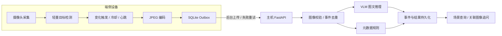

# Roadside Multimodal Agent

### 基于 Jetson 与 VLM 的端云协同多模态 Agent 系统

围绕路侧视觉事件构建 **采集检测 → 事件筛选 → 可靠上传 → 图文理解 → 场景追问** 的处理链路，将端侧感知与主机多模态推理组织成可部署、可回放、可评估的项目。

`Python` · `Jetson` · `jetson-inference` · `VLM` · `FastAPI` · `SQLite`

[快速开始](#快速开始) · [系统架构](#系统架构) · [端云部署](#端云部署) · [实验评估](#实验评估) · [技术文档](#技术文档)

## 项目背景

路侧摄像头持续产生图像，而主机多模态推理需要综合考虑网络传输、模型计算与请求排队。逐帧上传会重复发送相似场景，弱网络下的请求失败又容易造成事件丢失或重复处理。

本项目采用端云分工：端侧完成轻量检测、事件筛选与图像压缩，主机负责视觉语言理解和场景追问；通过持久化待发队列、请求去重和分段计时，把视觉交互组织为可追踪的事件处理流程。

## 核心设计

- **端云解耦：** 将摄像头与检测运行时保留在独立端侧客户端，使用统一事件协议连接主机服务，使设备采集与 VLM 后端分别配置、分别演进。
- **事件驱动上传：** 根据检测标签与目标数量变化触发上传，结合冷却窗口和周期心跳管理事件频率，避免相同检测状态持续触发请求。
- **持久化重传：** 使用 SQLite Outbox 保存待发送事件，由后台线程执行上传与指数退避；设备进程重启后继续处理队列，永久错误独立记录。
- **幂等事件处理：** 通过事件 ID、输入指纹和结果持久化识别重复上传；相同事件返回已有结果，冲突输入返回明确错误。
- **多模态交互：** 将 JPEG 图像、检测元数据与文本问题联合发送至 VLM，支持场景描述与针对同一事件图像的追问，并生成结构化记录与复核建议。
- **链路可观测：** 分别记录端侧处理、主机排队、VLM 调用和客户端往返时间，结合图像压缩实验分析传输开销与响应路径。

## 系统架构



端侧使用 `jetson-inference` 的 `detectNet` 处理摄像头图像；主机通过 OpenAI 兼容的图文接口连接 vLLM 或 `llama-server`。事件 ID 贯穿上传、结果存储和后续追问。

## 快速开始

主机环境：**Python 3.10+**。在项目根目录执行：

```powershell
python -m venv .venv
.\.venv\Scripts\Activate.ps1
python -m pip install -e ".[dev]"

$env:BACKEND='mock'
rma demo
rma serve
```

Linux 使用 `source .venv/bin/activate` 激活环境。`mock` 模式提供合成图像和固定模型响应，用于运行事件接收、结果存储、去重与追问流程；`openai` 模式连接 VLM 服务。

启动后打开 [交互式 API 文档](http://127.0.0.1:8000/docs)，或在另一个终端执行：

```powershell
python examples/client.py
```

### 事件回放

生成事件文件，通过与端侧相同的 HTTP 协议上传：

```powershell
rma fixtures --output artifacts/events.json
python edge/jetson_client.py replay --events artifacts/events.json --url http://127.0.0.1:8000
python edge/jetson_client.py stats
```

再次回放同一份事件文件，可观察主机返回 `replayed=true`。客户端在上传成功后清理待发记录，发送失败时将事件保留在 Outbox 中。

## 端云部署

### 1. 启动主机 VLM

在相应的模型运行环境中选择一个后端：

```bash
# vLLM：默认 Qwen3-VL-2B-Instruct
bash deploy/serve_vlm_vllm.sh

# llama.cpp：默认 SmolVLM-500M-Instruct-GGUF
bash deploy/serve_llamacpp.sh
```

两条路线统一使用端口 `8002`、模型服务名 `local-vlm`，应用通过同一图文协议接入。模型版本与资源配置见 [部署文档](docs/DEPLOYMENT.md)。

### 2. 启动主机事件服务

```powershell
$env:BACKEND='openai'
$env:VLM_BASE_URL='http://127.0.0.1:8002/v1'
$env:VLM_MODEL='local-vlm'

uvicorn rma.api:create_app --factory --host 0.0.0.0 --port 8000
```

### 3. 启动 Jetson 采集客户端

在 Jetson 的视觉运行环境中，复制 `edge/jetson_client.py`，配置摄像头与主机地址：

```bash
python3 jetson_client.py capture --camera /dev/video0 --node-id nano-01 --url http://YOUR_HOST_IP:8000 --network ssd-mobilenet-v2 --width 640 --quality 75 --cooldown 5 --heartbeat 30
```

替换 `YOUR_HOST_IP` 为主机局域网地址。端侧脚本支持 Python 3.6+，采集模式使用设备侧 `jetson_inference`、`jetson_utils`、NumPy 和 Pillow；主机与端侧依赖分别管理。

客户端参数、队列维护和部署步骤见 [端侧说明](edge/README.md) 与 [部署指南](docs/DEPLOYMENT.md)。

## 事件与 API

每个事件关联节点、采集时间、检测结果、JPEG 图像和用户问题：

```json
{
  "event_id": "road-event-001",
  "node_id": "nano-01",
  "captured_at": 0.0,
  "detections": [{"label": "car", "confidence": 0.9}],
  "question": "描述道路中的可见车辆。",
  "edge_processing_ms": 12.3
}
```

图像通过 `image_b64` 字段传输。`examples/client.py` 提供包含图像的完整事件与追问示例。

| 接口 | 用途 |
|---|---|
| `POST /v1/events` | 接收图像事件并生成场景描述与结构化结果 |
| `GET /v1/events/{event_id}` | 查询已处理事件 |
| `POST /v1/events/{event_id}/questions` | 对关联图像发起追问 |
| `GET /metrics` | 查看接收、去重、处理与错误累计数 |
| `GET /health` | 查看应用状态与后端配置 |

主机包含图像大小与格式校验、并发限制、整请求超时、上游重试与熔断。接口字段和错误码见 [API 文档](docs/API.md)。

## 实验评估

### 图像压缩与上传开销

```powershell
# 使用内置合成图像运行参数实验
rma compression --output artifacts/compression

# 使用自己的图像
rma compression --image your-road-image.jpg --output artifacts/road-compression
```

默认比较最长边 `320 / 640 / 960` 与 JPEG quality `40 / 65 / 85` 的九种组合，保留压缩图片、JPEG 字节数、Base64 字节数和编码耗时。

### 事件可靠性与分段计时

| 实验维度 | 操作 | 观察结果 |
|---|---|---|
| 请求去重 | 重复回放相同事件文件 | 已有结果重放与处理计数 |
| 断网重传 | 暂停主机服务后回放，恢复后执行 `flush` | Outbox 保留、重试与交付状态 |
| 上传门控 | 调整检测状态、冷却和心跳参数 | 事件触发频率与上传数量 |
| 压缩参数 | 固定图像，改变尺寸与质量 | 传输字节数与编码时间 |
| 处理链路 | 联合查看客户端与主机计时 | 端侧处理、排队、VLM 调用和请求往返 |

时延使用各端单调时钟测量；客户端往返时间与主机处理时间分别保留。实验设置、数据组织和质量评价方法见 [评估文档](docs/EVALUATION.md)。

## 测试与复现路线

仓库包含 **5 项自动测试**，覆盖事件去重与持久化、输入冲突、触发门控、Outbox 重试、图像校验、图文协议、鉴权、熔断与超时。

```powershell
python -m pytest
python scripts/verify.py
```

| 步骤 | 操作 | 验收结果 |
|---|---|---|
| 1. 本地演示 | `rma demo` | 事件处理、结果重放与图像关联追问 |
| 2. HTTP 回放 | `rma serve` + `replay` | 待发队列与主机接口连通 |
| 3. 模型接入 | 启动 VLM 并切换后端 | 图像、检测元数据与问题联合推理 |
| 4. 设备接入 | Jetson `capture` | 摄像头事件通过同一协议上传 |
| 5. 实验验证 | `compression` + `verify.py` | 压缩记录、自动测试与执行日志 |

验证输出保存在 `artifacts/verification/`；随仓库提供的 `evidence/` 包含合成图像演示、压缩记录和测试日志。

## 目录结构

```text
edge/       独立 Jetson 客户端与设备运行说明
src/rma/    事件服务、VLM 适配、图像处理与规则
deploy/     vLLM / llama.cpp 模型服务启动脚本
examples/   图像事件上传与追问示例
tests/      自动测试
scripts/    重复验证入口
evidence/   演示输出、压缩图片与测试记录
docs/       架构、部署、API 与评估说明
```

## 技术文档

| 文档 | 内容 |
|---|---|
| [架构与设计](docs/ARCHITECTURE.md) | 端云分工、事件门控、重传机制与计时设计 |
| [部署指南](docs/DEPLOYMENT.md) | 主机、模型后端与设备环境配置 |
| [端侧客户端](edge/README.md) | 采集参数、事件回放和 Outbox 维护 |
| [API 说明](docs/API.md) | 事件格式、图像传输、追问与错误码 |
| [评估方法](docs/EVALUATION.md) | 压缩、网络、事件和问答质量实验 |

## 开源与许可

端侧视觉接入 [jetson-inference](https://github.com/dusty-nv/jetson-inference)，主机通过图文接口对接 [Qwen3-VL](https://github.com/QwenLM/Qwen3-VL) 等模型，并提供 [llama.cpp](https://github.com/ggml-org/llama.cpp) 后端配置。事件协议、门控、重传、服务接口与评估流程维护在本仓库。

采用 [MIT License](LICENSE)。依赖归属、参考版本与开发说明见 [THIRD_PARTY_NOTICES.md](THIRD_PARTY_NOTICES.md)。
